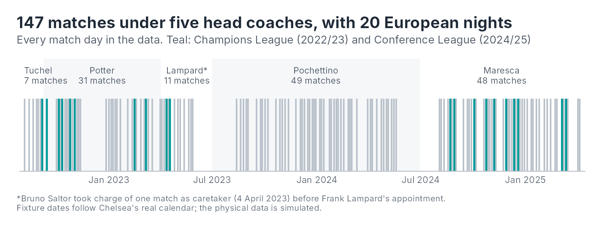

**The question this tool answers: is this player's load where it should be for this point in the match week?** It's built in R, from the raw GPS and recovery files to a self-serve Shiny app, with every decision written up along the way.

[Open the app](https://connect.posit.cloud/michael-davies-personal/content/01a1595f-e7f0-b63f-d2cf-a1ced13e3f21){.btn .btn-primary target="_blank"} [View the code on GitHub](https://github.com/michaeldavies64/load-recovery-monitoring){.btn .btn-outline-secondary target="_blank"}

[First version live]{.md-tag} The app is hosted on Posit Connect Cloud. After a quiet spell it takes about 10 seconds to wake up; the welcome page shows while it does.

## Context

### The Vizathon

In March 2025, Chelsea FC's Performance Insights team ran an open vizathon with one brief: create the most compelling physical performance interface for elite football players and their coaches. Entrants worked from a mock dataset covering load, physical development, recovery and individual priorities, and the competition drew 124 entries from 27 countries.

### The data

Four files describe a single player. The values are simulated, but the structure mirrors what a club's performance department collects. This tool uses the GPS file; the recovery file feeds a companion research question on how recovery responds to load.

| File | What it holds | Coverage |
|---|---|---|
| GPS | Daily training and match load: distance, high-speed running, accelerations, heart rate, with each day labelled by its position in the match week | August 2022 to April 2025 |
| Physical capability | Benchmark scores for 20 combinations of movement, quality and force expression | July 2023 to March 2025 |
| Recovery status | Daily scores across six categories, from sleep and soreness to blood markers | July 2023 to March 2025 |
| Individual priority areas | Three development targets agreed by the player and staff | March to May 2025 |

### The club around the data

The physical values are simulated, but the fixtures follow Chelsea's real calendar, and that calendar was unusually turbulent.

{fig-alt="Timeline of 147 match days from August 2022 to April 2025, shaded by head coach: Tuchel 7 matches, Potter 31, Lampard 11, Pochettino 49, Maresca 48. Twenty European matches are highlighted in teal."}

| Season | Head coaches | League | Europe |
|---|---|---|---|
| 2022/23 | Tuchel, Potter, Lampard (interim) | 12th | Champions League quarter-finals |
| 2023/24 | Pochettino | 6th | None; reached the League Cup final |
| 2024/25 | Maresca | 4th | Conference League, won in May 2025 (after the data ends) |

For load monitoring, the calendar matters as much as the numbers. A season with European football means more two-match weeks and shorter gaps to recover and build load between games; a season without it gives longer, more structured training weeks. Three coaching changes in one season would also mean three different training philosophies. Because this data is simulated I won't read coaching effects into it, but the tool is designed so that a real dataset could be split by these periods.

## What the tool needs to answer

Staff don't need every GPS metric every day. They need a few questions answered quickly:

- **Is today's load normal for this day of the match week?** Each session is compared with the player's own norm for that match-week day, so an MD-1 is judged against other MD-1s rather than against a match.
- **How is the week building?** Rolling load over the last 7 and 28 days shows whether the player is building, holding or dropping relative to their recent history.
- **What did the match ask of them?** Match load set against the player's typical full-match output, so a short appearance with a high sprint load stands out.

High-speed running above 21 km/h is the lead measure, with total distance, accelerations and decelerations, and session duration alongside.

## What's in the app

| Page | What it answers |
|---|---|
| Overview | Where the player is today: how many metrics are outside their normal range, the latest session, and the last 28 days of load |
| Profile | Who the player is, the current status of every metric, and what each type of day typically looks like |
| Longitudinal | How load has built over any period: daily, against the adaptive range, or as rolling 7- and 28-day load, with sessions outside their range marked |
| Session check | One session against its normal ranges, against the last 10 sessions of the same type, and the recovery scores that followed |
| Glossary | What every metric means and how the app uses it |

## How it's built

| Stage | What it does | Write-up | Status |
|---|---|---|---|
| 1. Data quality | Automated checks on all four files, and the cleaning rules that follow from them | [Data quality report](https://michaeldavies64.github.io/load-recovery-monitoring/data_quality.html){target="_blank"} | [Done]{.md-tag} |
| 2. Pipeline | Raw files into staging, features and monitoring schemas in DuckDB, with every transformation in SQL | [SQL in the repository](https://github.com/michaeldavies64/load-recovery-monitoring/tree/main/queries){target="_blank"} | [Done]{.md-tag} |
| 3. Features | Match-week labels, a full-match reference (85 to 125 minutes), per-minute and heart-rate band metrics | [Feature engineering report](https://michaeldavies64.github.io/load-recovery-monitoring/feature_engineering.html){target="_blank"} | [Done]{.md-tag} |
| 4. Adaptive ranges | A normal range for every metric on every type of day, learned from the player's own history and updated after each session | [Adaptive ranges report](https://michaeldavies64.github.io/load-recovery-monitoring/adaptive_ranges.html){target="_blank"} | [Done]{.md-tag} |
| 5. Shiny app | A self-serve app in Slate and Signal, split into ui, server, data visualisation and data management | [The app](https://connect.posit.cloud/michael-davies-personal/content/01a1595f-e7f0-b63f-d2cf-a1ced13e3f21){target="_blank"} | [Done]{.md-tag} |

The adaptive ranges follow [Roshan et al. (2021)](https://doi.org/10.1371/journal.pone.0247338), adapted for a single player. Every table carries a player ID, so a squad view can be added later without rework.

## Next

- A `targets` pipeline, so the whole project rebuilds from one command, and tests for the key tables.
- The companion research question: how recovery responds to load, using the same pipeline.

::: {.md-source}
**Data:** CFC Insights Vizathon 2025, Chelsea FC Performance Insights (simulated data for one player). Raw files are downloaded from the [public competition repository](https://github.com/Chelsea-Fc-Performance-Insights/Competition), not stored here. 
**Context:** [History of Chelsea F.C. (2022–present)](https://en.wikipedia.org/wiki/History_of_Chelsea_F.C._(2022%E2%80%93present)), [Chelsea in 2023/24](https://chelseafc.com/en/news/article/chelsea-in-2023-24-all-you-need-to-know), [The Analyst](https://theanalyst.com/articles/2022-23-chelsea-disaster-worst-points-regressions-premier-league-history/), [Premier League](https://www.premierleague.com/news/4316772), [Sports Illustrated](https://www.si.com/soccer/chelsea-win-2024-25-conference-league).
:::
